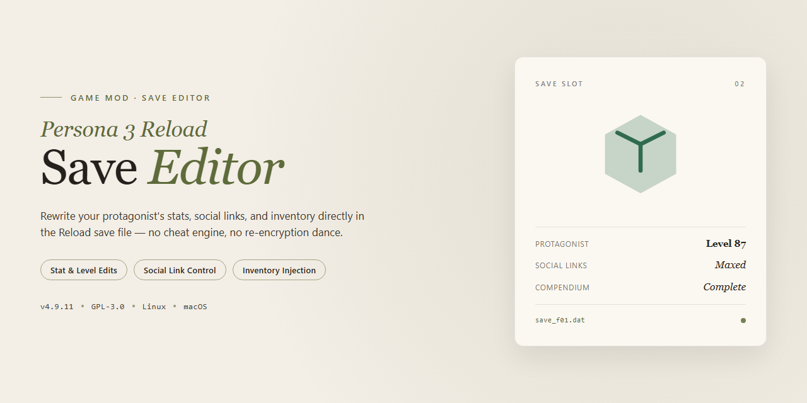

# 🧠 Persona 3 Reload Save Editor & Mod for Windows

### 🖥️ PowerShell Setup

   

---

The Dark Hour has secrets, and your save file is one of them. The Persona 3 Reload Save Editor is a modder's lantern in the labyrinth — a Windows tool built to pry open save data, adjust parameters, and reshape your journey through Tatsumi Port Island without sacrificing save integrity. Whether you're tweaking social stats for a completionist run or just curious how the game's internal clock ticks, this editor keeps every change transparent and backup-protected. Built for tinkerers, tested by tinkerers — your save, your rules, your Dark Hour.

## ✅ Before You Start

- Windows 10 or Windows 11
- PowerShell 5.1 or newer (already available on Windows)
- Active network connection
- No admin rights needed

## Overview: Your Velvet Room Toolkit

Welcome to the **Persona 3 Reload Save Editor** — a focused desktop toolkit built for Windows players who want to look under the hood of their save files without turning their journey into a gamble. This project grew out of a simple frustration: the Dark Hour is unforgiving enough on its own, and the tools available for tinkering with progression were either opaque, scattered, or one wrong click away from a corrupted file. So we built the equivalent of a well-kept Velvet Room workbench — precise instruments, labeled drawers, and a safety rail on every station.

Unlike a pile of disconnected utilities, this editor treats your save data as a single coherent artifact. Every module shares the same philosophy: show what is being touched, back it up before touching it, and make every change reversible. Whether you are a modder mapping out save structure, a completionist auditing bond ranks, or a player who simply wants to explore alternate configurations, the toolkit meets you where you are.

Three ideas hold the whole thing together:

- **Clarity over mystery.** No hidden writes, no cryptic routines. Each panel explains the fields it surfaces and the effect of any toggle you flip.
- **Reversibility as a rule.** A rolling backup vault keeps recent snapshots of your save directory, so a wrong turn is one action away from being undone.
- **Documentation as a feature.** This README is deliberately detailed because a toolkit is only as trustworthy as the notes that ship with it.

The toolkit runs as a native Windows application with a responsive interface that reflows cleanly from ultrawide monitors down to compact laptop panels. Modules are opt-in — enable only the inspectors and editors you actually need, and the UI stays lean.

It is, at its heart, a modder-friendly space: structured, documented, and built with respect for the game and for the people who love it. Your journey, your pace, your rules — with a safety net underneath.

## Feature Set: Powers of the Dark Hour

Step into the Velvet Room and take command of your own story. The Persona 3 Reload Save Editor doesn't just tweak a few numbers — it hands you the keys to the Dark Hour and lets you decide how the night unfolds. Every power below is built to be safe, reversible, and fully documented, so you can experiment with confidence and roll back whenever the shadows get too restless.

**💠 Progression Control** — Reshape your journey on your own terms. Adjust player level, experience curves, and social stats (Courage, Charm, Academics) with guarded sliders that preview changes before committing. Whether you want a breezy replay or a perfectly tuned completionist run, the numbers bend to your will.

**🎭 Social Link & Bond Editor** — Every bond tells a story. Track each confidant's rank, edit relationship progress, and unlock or reset link states across save slots. Great for testing alternate routes, planning a max-bond run, or simply fixing that one link you let slip through the alternatives.

**🃏 Persona Compendium ** — Summon the full registry to your fingertips. Browse registered personas, adjust their recorded levels and stats, and manage compendium entries without a single fusion accident. Build the roster you always wanted and carry it across playthroughs.

**👥 Party & Inventory Tools** — Inspect party composition history and fine-tune support items, consumables, and equipment counts. Keep your stocked and your loadout sharp before the next full-moon operation.

**📅 Calendar & Time Dials** — Time is the scarcest resource in Persona 3 Reload. View remaining days, map activities, and adjust supported calendar values to stretch or compress your schedule — perfect for squeezing in one more hangout or skipping ahead to a key date.

**🛡️ Backup Vault & Dry-Run Mode** — No change happens without a net. Automatic timestamped snapshots and a dry-run preview let you simulate every edit first, then commit only when you're sure. Checksum verification and one-click rollback keep your save files from ever becoming casualties of the Dark Hour.

**🖥️ Trainer Overlay (In-Session Tweaks)** — For live sessions, the companion trainer surfaces quick toggles for supported values like HP, SP, and money — no menu digging required. Flip a switch, watch the effect, and disable it just as fast.

**🧩 Modular by Design** — Enable only the modules you need. Each tool is self-contained, clearly labeled, and fully reversible, so your interface stays lean and your save stays pristine.

Every feature is documented in plain language, and every writable field is flagged as such — no mystery bytes, no hidden routines. The Dark Hour is yours to command; we just hand you the mask.

## Installation: Summoning the Editor

Before you can reshape destiny, you need to open the door. Summoning the Persona 3 Reload Save Editor is a ritual with three steps: acquire the artifact, extract it, and awaken it.

**Step 1 — Claim the artifact.** The save editor arrives as a single compressed package. Save it somewhere quiet and memorable on your drive — your Documents folder is a fine home, but the choice is yours. Avoid tucking it into a temporary location; the editor expects a stable residence and dislikes vanishing doors.

**Step 2 — Break the seal.** Extract the archive to a folder you control. Use the extraction tool you trust most. Once the archive is unpacked, the folder should contain the editor's executable alongside its supporting files — keep these companions together, for the editor draws power from its neighbors. If you separate them, it may refuse to awaken.

**Step 3 — Awaken the editor.** Locate the executable and set it running. Windows may murmur about permissions — grant them freely, as the editor touches save data and needs room to work. On first launch it will quietly announce itself and settle into place. If a security prompt appears, recognize the tool you just summoned rather than a stranger at the gate.

**Step 4 — Answer the editor's questions.** The first run may ask where your saves live. Point it toward the folder that holds your save data, or let it search on its own. Nothing is written until you give the word — the editor observes first, acts later.

**Step 5 — Open the Velvet Room.** With the save folder acknowledged, the main window materializes and your save slots line up for inspection. From here the editor reads first and writes only when you decide. If no save appears, confirm the file is one the editor supports, shut down the game if it is open, and try again.

A few quiet rules of the ritual:

- Always tend your own backup before tampering with fate. The editor keeps its own safety net, but two nets catch more than one.
- Keep the application folder intact — moving the executable alone breaks the circle.
- If an update is offered within the editor, accept it. New patches to the game mean the editor should be fresh as well.

Summon complete. The Dark Hour awaits your hand on the dial.

## Compatibility: System Requirements & Supported Builds

Before you summon this editor into your, let's make sure the stage is set. This toolkit was forged and tested on Windows, and it expects a few things to be true about your machine and your copy of Persona 3 Reload. Read this like a contract with the Velvet Room — the terms are short, but they matter.

### 🖥️ Operating System

The editor is built for modern Windows and runs best where it was raised:

- **Windows 11** — fully supported. This is the environment we recommend and test against most heavily.
- **Windows 10** — fully supported on recent builds (21H2 and later). Older builds will likely run, but expect the occasional cosmetic quirk with window scaling and DPI.
- **Windows 8.1 and below** — not supported. It may launch, but it has not been tested, and we make no promises about save integrity on unsupported platforms. If you walk that path, do it with a full backup in hand.

### 🎮 Game Version

The editor targets the **current retail build** of Persona 3 Reload on Windows. Save structures can shift when the game receives patches, so:

- Keep the game updated to the latest official release.
- If a patch changes save internals, an editor update will follow promptly — check the release notes before reporting a mismatch.
- **Demo builds, review copies, and modified game binaries are not supported.** Save data from these sources may use different structures, and the editor will refuse to write rather than guess.

### 🧱 Hardware Baseline

Nothing exotic is required — this is a save-file tool, not a renderer:

- A 64-bit Windows installation.
- Roughly **150 MB of free disk space** for the application plus room for the backup vault (allow a few hundred megabytes more if you keep many snapshots).
- A minimum display of **1366×768**; the interface scales up cleanly for 1080p, 1440p, and ultrawide panels.
- Standard user permissions for reading and writing to your save directory. Running as Administrator is only needed if your save folder sits in a protected location.

### 💾 Save File Compatibility

Not every save is treated equally — handle your data like an artifact recovered from Tartarus:

- **Retail, unmodified saves** are fully supported and are the primary target.
- **Saves previously touched by other editors or trainers** may load in read-only inspection mode, but writable modules will validate structure before committing and bail out if checksums do not match.
- **Cloud-synced saves** (such as those managed by platform launchers) should be synced down and closed before editing, then allowed to sync back up afterward. Editing mid-sync is a recipe for conflict — let the cloud settle first.
- **Multiple profiles and New Game Plus files** are each treated as their own save slot; the backup vault keeps separate lineages for each.

### 🚫 What We Do Not Support

To keep the contract honest, a short list of things outside the circle:

- Non-Windows platforms, including compatibility layers and emulation wrappers.
- Modified game executables or saves produced by unknown tools.
- Save files shared across different regional builds when structures diverge.
- Any scenario where a backup cannot be created — the editor will stop rather than proceed blind.

### 🛡️ The Safety Clause

Every writable action is gated behind the same three checks: a timestamped backup, a structural validation pass, and a post-write checksum verification with automatic rollback on mismatch. If your environment fails any of these gates, the editor declines the change. That is not a bug — that is the contract holding.

If your matches the above, you are cleared to proceed. Keep the game patched, keep your backups close, and the Dark Hour will treat you kindly.

## Credits: The Team Behind the Mask

Every tool has a face behind the mask, and this one is no different. The Persona 3 Reload Save Editor wasn't summoned by a single hand — it was shaped by a circle of modders, tinkerers, and save-file archaeologists who believe that your journey through the Dark Hour should bend to your will, not the other way around.

**The Core Circle** — the ones who mapped the byte-level terrain of save structures, reverse-engineered the calendar and social-link fields, and kept the write paths guarded with backups at every turn. They built the editor so you could tinker without fear and roll back without regret.

**The Field Testers** — players who ran the editor through every arcana of a playthrough, flagged edge cases before they became headaches, and confirmed that a tweak to one stat never quietly broke another. Their save files told the real story.

**The Scribes** — the documentation crew who turned hex walls into human-readable labels, wrote the troubleshooting notes, and made sure a newcomer could open the editor and understand exactly what each toggle would do before touching it.

**The Translators** — volunteers who carried the interface across languages so that no modder had to wrestle with a menu they couldn't read. Every locale file is a small act of welcome.

**The Community** — the modders, tinkerers, and curious players who filed thoughtful reports, shared findings, and kept the project honest. You are the reason the mask fits.

And a quiet nod to the original creators of Persona 3 Reload, whose world inspired a toolkit like this in the first place. We build on their foundation with respect — and we keep our tools unofficial, our backups automatic, and our doors open to anyone who wants to help refine the craft.

The Dark Hour is long, but it's better with company. Thank you for being part of the behind the mask.

## License & Disclaimer: Terms of the Contract

By using the Persona 3 Reload Save Editor, you agree to the following terms. If these terms feel unreasonable, close the tool and walk away — no hard feelings, and no strings attached.

**What you're actually getting.** This editor is an unofficial, community-built project. It is not affiliated with, endorsed by, sponsored by, or in any way blessed by the developers or publishers of Persona 3 Reload. Every trademark, character name, and in-game asset referenced by the tool belongs to its respective owner. We're guests in their world — we just built a better key for the door.

**Use it on your own save.** The editor is provided for personal, educational, and archival use. You are responsible for respecting the terms of service of any software you own, and for keeping independent backups of your save files before you poke at anything. The Backup Vault helps, but paranoia is a virtue — keep a copy somewhere safe anyway.

**No warranty, no promises.** This software is offered as-is, without warranty of any kind, express or implied. Create a corrupted save, overwrite the wrong slot, or rewrite the timeline in a way the game never expected, and the maintainers accept no liability for the consequences. You hold the editor; you hold the responsibility.

**Mod freely, share kindly.** You're welcome to fork, tweak, translate, and remix this project for your own use and for the community. If you redistribute a modified version, keep the credit honest and don't pretend it's official. Don't sell it, don't bundle it with anything malicious, and don't use it to harm other players' saves.

**The contract in one line.** The Dark Hour is yours to shape — but you carry the risks of the shape you give it, and you play fair with everyone else who walks the same night.

Should these terms ever change, the latest version will live right here in this README. Continuing to use the editor after an update means you accept the revised terms. Simple as that.